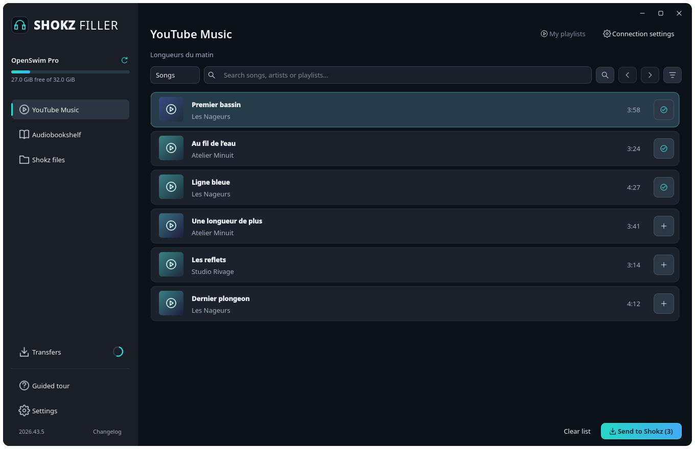
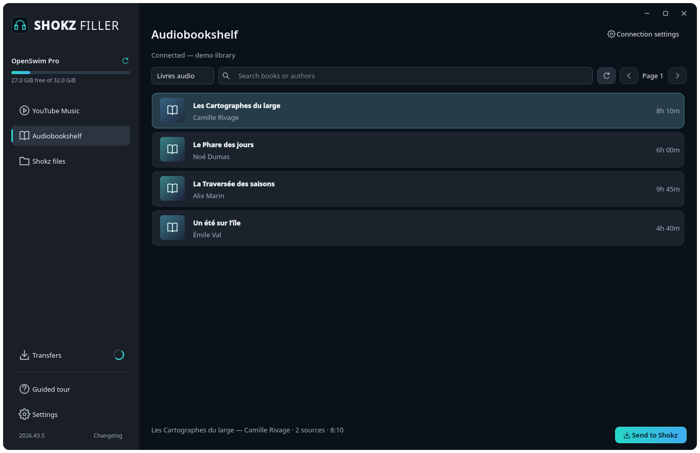
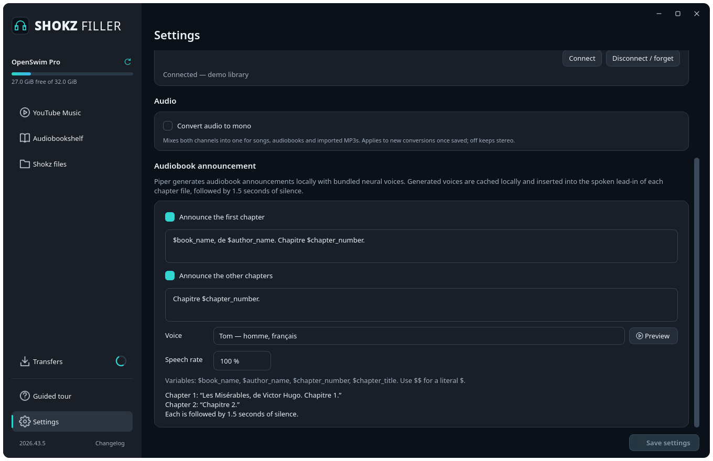

# Shokz Filler

[](https://github.com/simon-verbois/shokz-filler/stargazers)
[](https://github.com/simon-verbois/shokz-filler/forks)
[](https://github.com/simon-verbois/shokz-filler/releases)
[](https://github.com/simon-verbois/shokz-filler/releases/latest)
[](https://github.com/simon-verbois/shokz-filler/issues)
[](https://github.com/simon-verbois/shokz-filler/blob/main/LICENSE)

**Your music and audiobooks, ready to take along on your Shokz.**

A desktop app for searching YouTube Music, preparing compatible MP3 files and managing your Shokz USB storage. It includes Audiobookshelf and local spoken introductions for audiobooks.

[Website and usage guide](https://simon-verbois.github.io/shokz-filler/) · [Downloads](https://github.com/simon-verbois/shokz-filler/releases/latest) · [Report an issue](https://github.com/simon-verbois/shokz-filler/issues)

[](https://buymeacoffee.com/simonverbois)

Website languages: [English](https://simon-verbois.github.io/shokz-filler/) · [Français](https://simon-verbois.github.io/shokz-filler/fr/) · [Nederlands](https://simon-verbois.github.io/shokz-filler/nl/) · [Deutsch](https://simon-verbois.github.io/shokz-filler/de/) · [Español](https://simon-verbois.github.io/shokz-filler/es/)



_Real application screenshots with fictional demonstration data. The desktop interface is in English._

> **Feature availability.** This README and the website describe the current application. The older `2026.41.1` release predates Audiobookshelf, audiobook merging and Piper speech synthesis; use a newer release for these features.

## What it does

- **YouTube Music**: search tracks and playlists, select multiple songs, download an entire playlist and access playlists from your account.
- **Audiobookshelf**: connect to your server, search and choose books to take along. Each book gets **one folder** with **one numbered MP3 per chapter** (`01 - Title.mp3`, `02 - …`), so you always know where you are in the book.
- **Offline spoken introductions**: eight bundled Piper voices across French, English, German, Dutch and Spanish, **100%** default speed, normalised volume and **1.5 seconds of silence**. Two customisable texts: one before the first chapter and one before the others, with `$book_name`, `$author_name`, `$chapter_number` and `$chapter_title`.
- **Device management**: check free space, create and organise folders, import local MP3 files and confirm deletions. `SYSTEM` and `System Volume Information` are hidden from the browser and folder pickers.
- **Verified transfers**: recognise duplicates, preserve files on name conflicts, validate partial files and verify SHA-256 integrity before publishing the final file.

Conversions produce **MP3 CBR 192 kb/s · 44.1 kHz · stereo · ID3v2.3** (an optional Settings switch converts to mono). Local MP3s that already match the target format are copied directly; others are normalised without changing the originals. Portable builds include Python, Qt, FFmpeg, Piper and their dependencies and voice models.

## Install

Download the file for your operating system from the [GitHub releases](https://github.com/simon-verbois/shokz-filler/releases/latest).

| System         | File                              |
| -------------- | --------------------------------- |
| Linux x86_64   | `Shokz-Filler-linux-x86_64`       |
| Windows x86_64 | `Shokz-Filler-windows-x86_64.exe` |

On Linux, make the file executable and launch it:

```bash
chmod +x Shokz-Filler-linux-x86_64
./Shokz-Filler-linux-x86_64
```

On Windows, launch the `.exe`. No separate Python or FFmpeg installation is needed to use a portable build.

## First use

A nine-step **Guided tour** opens on first launch. Skip it at any time, or reopen it from the sidebar above **Settings**. It works without an account or connected device.

1. Connect your Shokz by USB and open their storage on your computer.
2. In **Shokz files**, select the device. If necessary, use **Browse…** to select its mounted volume.
3. For music, open **YouTube Music**, search for songs or open a playlist, and add songs to the **send list** with **+** (or double-click, or right-click → *Add to send list* / *Add all songs to send list*). The list keeps its order across searches and playlists, and that order becomes the playback order.
4. Click **Send to Shokz (N)** to open the transfer assistant: review or reorder the songs, then choose a folder on the device or create one. A playlist's own name is suggested when all songs come from it.
5. Follow progress in **Transfers**: the sidebar shows the live count and overall progress on every screen. **Retry selected** restarts failed or cancelled items; **Cancel selected** requests cancellation.
6. Wait for transfers to finish and eject the headset through your operating system before unplugging it.

Use the sidebar or `Alt+1` to `Alt+5` to switch screens. The device summary and transfer progress stay visible in the sidebar. Accounts and preferences all live in **Settings**. Music sorting and filters are available from the filter button above the results.

Public search does not require a YouTube account. To use **My playlists**, open **Settings → Accounts** and click **Connect** next to YouTube Music:

1. Choose your browser if several are installed, then click **Open YouTube Music**.
2. Sign in normally in the browser. Return to Shokz Filler: it imports and validates the session automatically. If you are already signed in, click **I'm signed in — Connect** directly.

There is no Google Cloud setup, client ID, secret, script or browser extension to install. Connecting imports the selected browser's session locally and saves only cookies applicable to YouTube Music. The browser's main Google account is used. Your Google password is never requested by Shokz Filler. The saved session also supplies cookies to the media downloader. **Disconnect** removes the application's local copy; it does not sign you out of your browser.

Supported browsers are Firefox, Chrome, Edge, Brave and Chromium on Linux and Windows. Use a normal window, not private browsing. Browser protections can prevent cookie access, especially in Chromium-based browsers on Windows: close the browser and retry, or use Firefox. **Advanced connection options** retains manual request-header import as a fallback. Existing saved sessions continue to work.

The [illustrated usage guide](https://simon-verbois.github.io/shokz-filler/#guide) covers each workflow, voice settings and interrupted transfers in all five website languages.

## Take an Audiobookshelf book along



To export a book:

1. Select your headset in **Shokz files** first.
2. In **Settings → Audiobookshelf** (also reachable from the Audiobookshelf screen with **Connection settings**), enter **Server**, **Username** and **Password**, then click **Connect**. The address must include `https://` or `http://`.
3. Choose a library and select books, then click **Send to Shokz**.
4. The books are queued straight away, with the announcement choices from **Settings** (no popup).
5. The app downloads the sources, converts them into one MP3 per chapter, and copies the files one at a time, in order, into the book’s own folder.

The announcement is enabled by default. **Settings** lets you turn it off, choose the voice, speed and text, and preview the voice, for example:

```text
You are listening to $book_name.
A book by $author_name.
```

Choose **John** for an English announcement or **Tom** for French. Speech synthesis is entirely local. Downloading books requires access to your server and an account with download permission. The connection, including the password, is remembered in a private per-user file; **Disconnect / forget** removes it.

<details>
<summary>View the voice settings</summary>



</details>

## Things to know

- The conversion target is fixed. Audiobookshelf sources can include M4B, M4A, MP3, FLAC, Ogg/Opus and WAV, depending on the formats FFmpeg can decode.
- Shokz documents two behaviours (name order in the help article, transfer time in the OpenSwim Pro FAQ), so every file is zero-padded by position **and** copied sequentially in that order, and TRCK tags are written. The firmware's real behaviour still needs a manual check on each model.
- Optional spoken chapter numbers: the first file says the book, author and chapter 1; the others only their chapter number.
- Audiobookshelf exports exceeding the conservative **4 GiB per-file** limit are refused. Allow space on your computer for the conversion cache too.
- Duplicate detection uses identifiers embedded in MP3 files. Matching titles or authors alone are not conclusive evidence of a duplicate.
- Downloads require access to the media and the appropriate rights. The app does not bypass DRM.
- This is an independent project, not affiliated with Shokz, YouTube or Audiobookshelf.

## Support the project

If Shokz Filler is useful to you, you can support its development by [buying me a coffee](https://buymeacoffee.com/simonverbois).

You can also help by starring the [public GitHub repository](https://github.com/simon-verbois/shokz-filler), reporting bugs or sharing the app.

## Develop and build

The app uses Python 3.11+ and PySide6. These commands apply to the development checkout shown here; the GitHub mirror receives application code at release time. From that checkout, on Linux:

```bash
python3 -m venv .venv
.venv/bin/pip install -e '.[dev]'
.venv/bin/python scripts/fetch_tts_voices.py
scripts/fetch_ffmpeg_linux.sh
./start-shokz-filler.sh
```

The voice models are fetched from pinned revisions and verified by SHA-256. Portable executables include them afterwards; speech synthesis does not contact a service.

```bash
QT_QPA_PLATFORM=offscreen .venv/bin/python -m pytest
.venv/bin/python -m ruff check .
.venv/bin/python -m ruff format --check .
.venv/bin/python -m mypy
python3 scripts/build_site.py --check
scripts/build_linux.sh
```

Windows builds run natively using `scripts/build_windows.ps1`. Forgejo CI publishes releases and the GitHub mirror when a release tag is pushed.

[Full technical guide](docs/development.md) · [Third-party notices](THIRD_PARTY_NOTICES.md) · [Source code licence](LICENSE)

## Multilingual GitHub Pages site

The static website lives in `docs/`. It follows the Inkora and Komga Meta Manager approach: a dependency-free Python build and a manually triggered Pages workflow. English is the default; French, Dutch, German and Spanish have their own static pages. Switching languages preserves the current tutorial section. No browser-side translation service is used.

Edit `docs/site-template.html` and the complete catalogues in `docs/locales/`, then regenerate and validate the committed pages:

```bash
python3 scripts/build_site.py --generate
python3 scripts/build_site.py --check
python3 scripts/build_site.py
python3 -m http.server 8000 --directory build/site
```

The build rejects missing translations, stale generated pages and broken local links. It publishes only explicitly allowlisted public assets. The [desktop design notes](docs/ui-design.md) describe the native UI and its interaction rules. Regenerate screenshots with fictional data using `.venv/bin/python scripts/capture_screenshots.py`. In GitHub Actions, run **Shokz Filler presentation site** on the default branch to publish.
